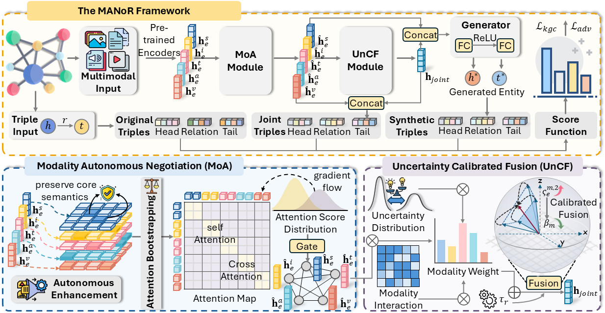

# Agree to Disagree: Multimodal Autonomous Negotiation and Calibration for Entity Representation Learning
> Learning high-quality multimodal entity representations is essential for advancing reasoning tasks such as Multimodal Knowledge Graph Completion (MMKGC). However, existing fusion strategies typically enforce rigid alignment to a dominant anchor modality, resulting in the loss of fine-grained specificity and the propagation of noise. To address these limitations, we propose MANoR, a novel framework with Multimodal Autonomous Negotiation for Calibrated Representation Learning. MANoR establishes a “negotiation-before-fusion” paradigm by treating modalities as autonomous agents. Specifically, it enables modalities to preserve their intrinsic feature manifolds via centroid-based projection while dynamically integrating evidence through uncertainty calibration. This approach effectively resolves the conflict between maintaining modality distinctiveness and filtering noise. Extensive experiments demonstrate that MANoR significantly outperforms state-of-the-art baselines, achieving substantial Hits@1 gains of up to 22.17% on KVC16K and consistent improvements across MKG-W, MKG-Y, and TIVA. Our code is in the supplementary material.

## Overview


## Data Download
We use the MMKG datasets proposed in NativE. You can refer to this paper to download the multimodal embeddings of the MMKGs and put them in embeddings/. 

## Dependencies
- Python==3.8
- numpy==1.23.3
- scikit_learn==1.1.2
- torch==1.9.1
- tqdm==4.64.1
- Maybe other library version also works.

## Train and Evaluation
You can refer to the training scripts in scripts/ to reproduce our experiment results. Here is an example for MKG-Y dataset.

```bash
DATA=MKG-Y
EMB_DIM=250
NUM_BATCH=1024
MARGIN=4
LR=1e-4
LRG=1e-4
NEG_NUM=128
MU=0.0001
EPOCH=500

CUDA_VISIBLE_DEVICES=0 nohup python run_mkg.py -dataset=$DATA \
  -batch_size=$NUM_BATCH \
  -margin=$MARGIN \
  -epoch=$EPOCH \
  -dim=$EMB_DIM \
  -save=./checkpoint/$DATA-$NUM_BATCH-$EMB_DIM-$NEG_NUM-$MU-$MARGIN-$LR-$LRG-$EPOCH \
  -neg_num=$NEG_NUM \
  -mu=$MU \
  -learning_rate=$LR \
  -lrg=$LRG > $DATA-$EMB_DIM-$NUM_BATCH-$NEG_NUM-$MU-$MARGIN-$LR-$LRG-$EPOCH.txt 2>&1 &
```

